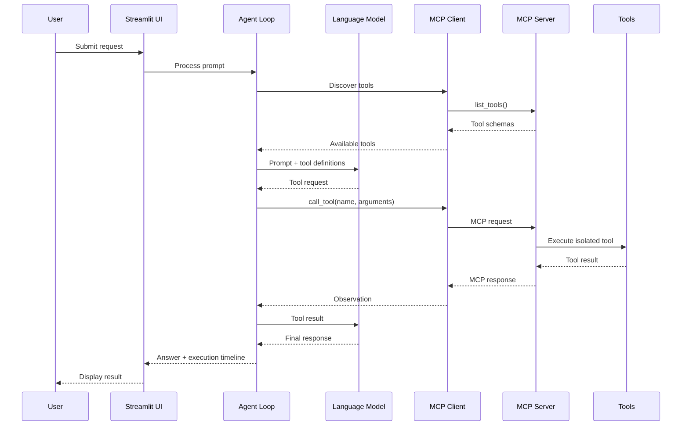

# MCP Enterprise Operations Assistant

A secure tool-augmented operations assistant built with the Model Context Protocol (MCP).

The system connects an agent to three isolated tools:

- read-only SQLite queries
- live weather data
- deterministic mathematical evaluation

It uses MCP over standard I/O for tool discovery and execution, with security controls around database access, code execution, external API responses, and multi-step tool orchestration.

## Architecture



## Tools

### SQL Database Query Tool

`query_sql_database`

Provides read-only access to the local SQLite operations database.

Security controls:

- SQLite opened with `mode=ro`
- `PRAGMA query_only = ON`
- SQL parsed before execution
- only approved read operations are allowed
- DDL and DML statements are rejected
- stacked queries are blocked
- results are limited to 50 rows

### Live Weather Tool

`get_live_weather`

Retrieves current weather information using the Open-Meteo API.

The tool includes:

- city normalization
- asynchronous HTTP requests
- request timeouts
- redirect protection
- structured weather output
- sanitized external API responses

Open-Meteo does not require an API key.

### Safe Math Evaluator

`evaluate_math_expression`

Evaluates mathematical expressions using Python's Abstract Syntax Tree.

The evaluator allows only approved:

- numeric constants
- arithmetic operators
- unary operators
- mathematical functions

It does not use Python `eval()` or `exec()`.

Imports, attribute access, arbitrary function calls, comprehensions, lambdas, and other executable Python constructs are rejected.

## Project Structure

```text
mcp-agent-tools/
├── data/
│   └── enterprise_ops.db
├── src/
│   ├── init_db.py
│   ├── app.py
│   ├── server/
│   │   ├── mcp_server.py
│   │   └── tools/
│   │       ├── sql_tool.py
│   │       ├── weather_tool.py
│   │       └── math_tool.py
│   └── client/
│       ├── mcp_client.py
│       └── agent_loop.py
├── tests/
├── ai_prompt_log.md
├── Dockerfile
├── docker-compose.yml
├── .env.example
├── .gitignore
└── pyproject.toml
```

## MCP Compatibility

This project targets the MCP Python SDK 1.x API and uses:

- `FastMCP`
- `ClientSession`
- stdio transport

The dependency is pinned to:

```text
mcp[cli]>=1.28,<2
```

## Setup

Python 3.11+ is recommended.

Create the virtual environment:

```bash
uv venv --python 3.11
```

Activate it:

```bash
source .venv/bin/activate
```

Install dependencies:

```bash
uv pip install -e '.[dev]'
```

Initialize the local database:

```bash
python -m src.init_db
```

## Environment Variables

Copy the example environment file:

```bash
cp .env.example .env
```

Optional:

```text
OPENAI_API_KEY=your_key_here
```

Without an OpenAI API key, the application can use its local deterministic planner while still performing real MCP tool discovery and MCP tool execution.

## Run the Application

Start the Streamlit interface:

```bash
PYTHONPATH=. python -m streamlit run src/app.py
```

Open:

```text
http://localhost:8501
```

## Run the MCP Server

The MCP server can also be started independently:

```bash
PYTHONPATH=. python -m src.server.mcp_server
```

The server communicates over standard input/output and normally waits for an MCP client connection.

## Example Multi-Tool Request

```text
Check if our inventory in Seattle has enough stock of SKU-90210 to fulfill order #4492, verify if rainfall there will delay ground dispatch today, and calculate the total shipping insurance cost at 3.5% of the order value.
```

This workflow coordinates:

1. SQL lookup
2. live weather retrieval
3. mathematical evaluation
4. final response synthesis

## Security

### SQL Injection / Destructive Query Protection

Example blocked payload:

```sql
SELECT * FROM orders; DROP TABLE inventory;--
```

The request is rejected before execution because multiple statements and destructive SQL operations are not permitted.

The SQLite connection is also opened in read-only mode as an additional enforcement layer.

### Arbitrary Code Execution Protection

Example blocked payload:

```python
__import__('os').listdir('.')
```

The expression is rejected because the AST contains non-whitelisted function calls and names.

The math tool never executes arbitrary Python code.

### Tool Loop Protection

The agent loop has a fixed maximum number of iterations.

Tool failures are returned as structured errors rather than causing uncontrolled execution or infinite retries.

## Testing

Run the full test suite:

```bash
pytest -v
```

The tests cover:

- SQL query correctness
- weather response formatting
- mathematical precision
- MCP tool discovery
- chained tool execution
- destructive SQL rejection
- arbitrary code execution blocking

## Security Audit

See [`ai_prompt_log.md`](ai_prompt_log.md) for the implementation audit and security hardening notes.

Key improvements include:

- replacing unsafe mathematical execution with AST-based validation
- enforcing parser-based SQL validation and read-only database access
- validating MCP tool schema translation
- enforcing bounded agent execution loops

## Docker

Build and run the application with:

```bash
docker compose up --build
```

Then open:

```text
http://localhost:8501
```